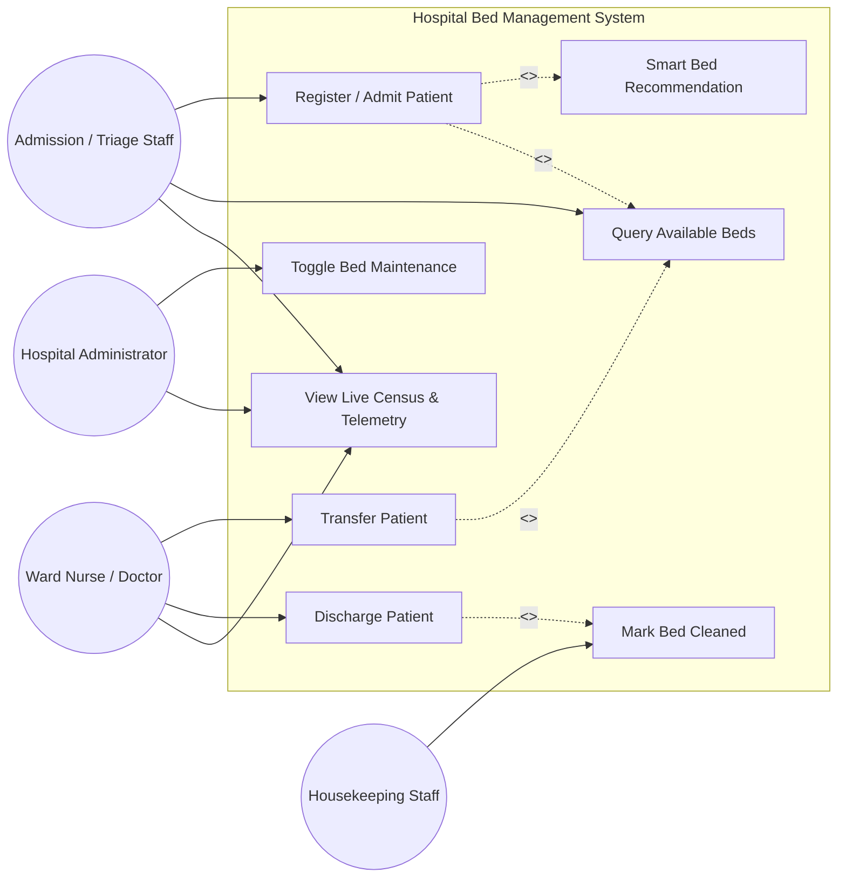
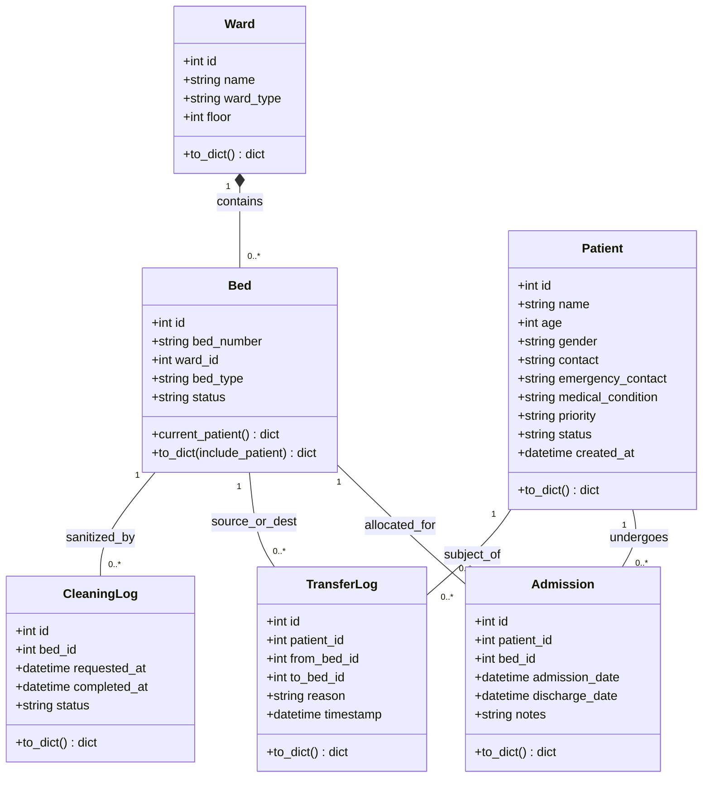
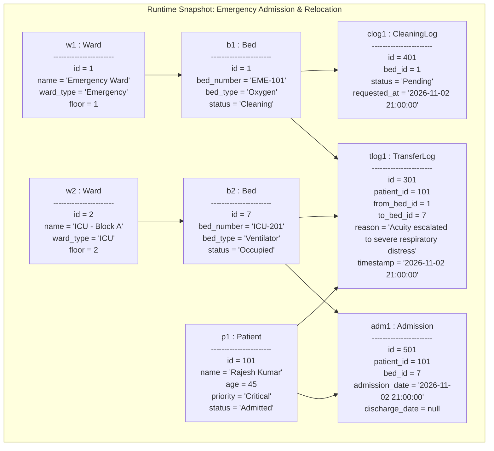
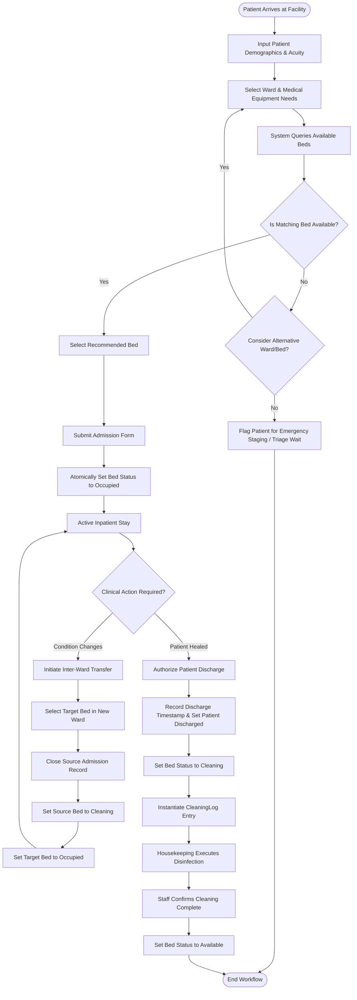
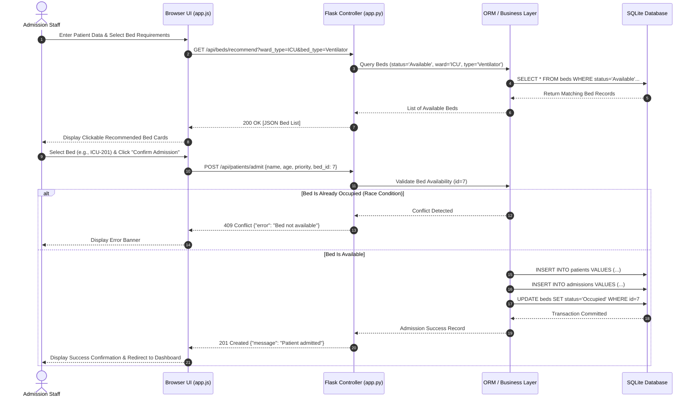
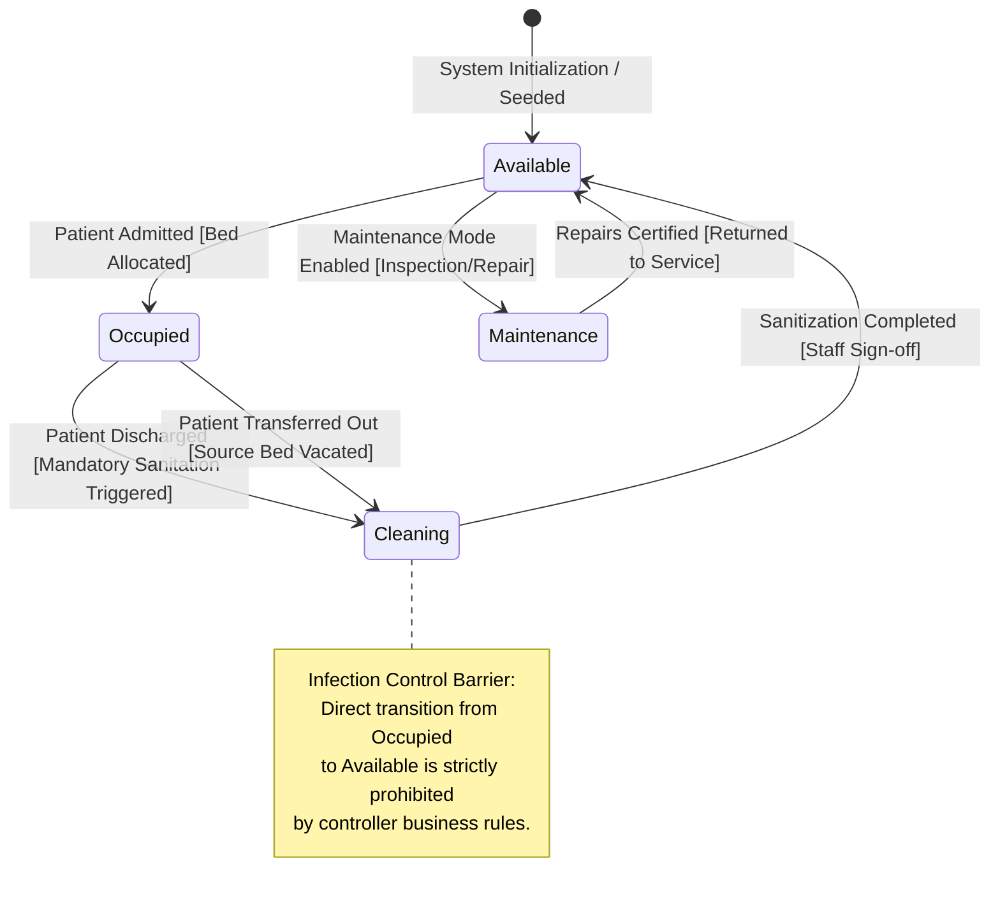
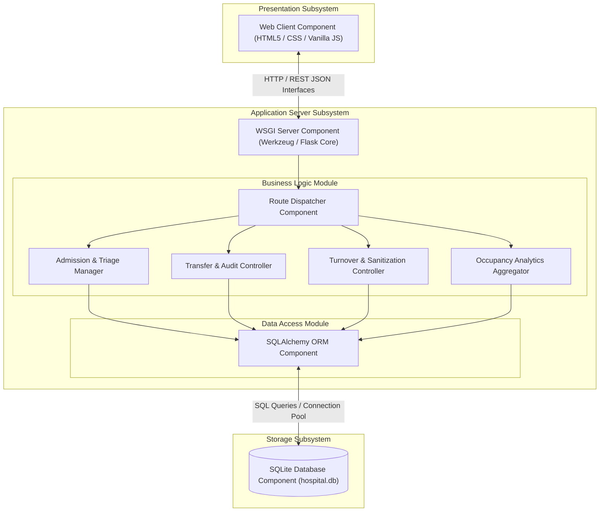
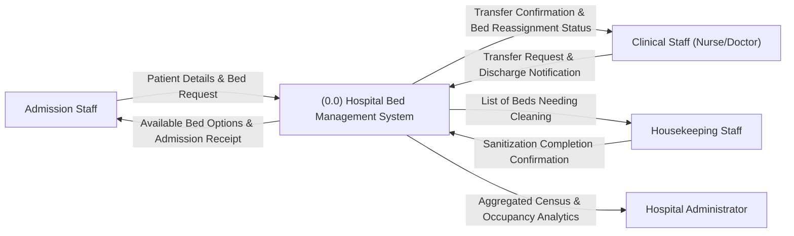
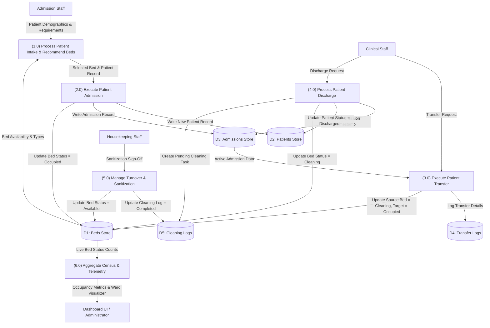
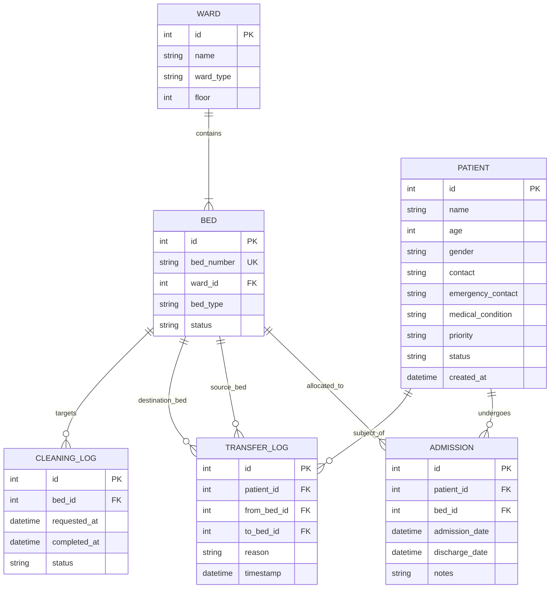

# Software Requirements Specification
## for
# Hospital Bed Management System (HBMS)

**Prepared by:**  
Piyush Prakash Sharma (2427030222)  
Team: Cuphead  
Manipal University Jaipur  

---

## Table of Contents
- [1. Introduction](#1-introduction)
  - [1.1 Purpose](#11-purpose)
  - [1.2 Document Conventions](#12-document-conventions)
  - [1.3 Intended Audience and Reading Suggestions](#13-intended-audience-and-reading-suggestions)
  - [1.4 Product Scope](#14-product-scope)
  - [1.5 References](#15-references)
- [2. Overall Description](#2-overall-description)
  - [2.1 Product Perspective](#21-product-perspective)
  - [2.2 Product Functions](#22-product-functions)
  - [2.3 User Classes and Characteristics](#23-user-classes-and-characteristics)
  - [2.4 Operating Environment](#24-operating-environment)
  - [2.5 Design and Implementation Constraints](#25-design-and-implementation-constraints)
  - [2.6 User Documentation](#26-user-documentation)
  - [2.7 Assumptions and Dependencies](#27-assumptions-and-dependencies)
- [3. External Interface Requirements](#3-external-interface-requirements)
  - [3.1 User Interfaces](#31-user-interfaces)
  - [3.2 Hardware Interfaces](#32-hardware-interfaces)
  - [3.3 Software Interfaces](#33-software-interfaces)
  - [3.4 Communications Interfaces](#34-communications-interfaces)
- [4. System Features](#4-system-features)
  - [4.1 Ward & Bed Inventory Management](#41-ward--bed-inventory-management)
  - [4.2 Patient Admission & Smart Bed Allocation](#42-patient-admission--smart-bed-allocation)
  - [4.3 Bed Transfer & Patient Relocation Workflow](#43-bed-transfer--patient-relocation-workflow)
  - [4.4 Housekeeping & Sanitization Turnover Lifecycle](#44-housekeeping--sanitization-turnover-lifecycle)
  - [4.5 Bed Maintenance & Out-of-Service Management](#45-bed-maintenance--out-of-service-management)
  - [4.6 Real-Time Occupancy Analytics & Dashboard Monitoring](#46-real-time-occupancy-analytics--dashboard-monitoring)
- [5. Other Nonfunctional Requirements](#5-other-nonfunctional-requirements)
  - [5.1 Performance Requirements](#51-performance-requirements)
  - [5.2 Safety Requirements](#52-safety-requirements)
  - [5.3 Security Requirements](#53-security-requirements)
  - [5.4 Software Quality Attributes](#54-software-quality-attributes)
  - [5.5 Business Rules](#55-business-rules)
- [6. Other Requirements](#6-other-requirements)
- [Appendix A: Glossary](#appendix-a-glossary)
- [Appendix B: Analysis Models](#appendix-b-analysis-models)
  - [Use Case Diagram](#use-case-diagram)
  - [Class Diagram](#class-diagram)
  - [Object Diagram](#object-diagram)
  - [Package Diagram](#package-diagram)
  - [Activity Diagram](#activity-diagram)
  - [Sequence Diagram](#sequence-diagram)
  - [State Chart Diagram](#state-chart-diagram)
  - [Component Diagram](#component-diagram)
  - [Deployment Diagram](#deployment-diagram)
  - [Data Flow Diagram (DFD Level 0 & Level 1)](#data-flow-diagram)
  - [Entity-Relationship Diagram (ERD)](#entity-relationship-diagram)
- [Appendix C: To Be Determined List](#appendix-c-to-be-determined-list)

---

## 1. Introduction

### 1.1 Purpose
The purpose of this Software Requirements Specification (SRS) is to define the functional and non-functional requirements for the **Hospital Bed Management System (HBMS), Version 1.0**. The system provides real-time visibility, tracking, allocation, and lifecycle management of physical hospital beds across diverse clinical departments (such as Emergency, Intensive Care Units, General Wards, Pediatric, and Surgical Recovery). It formalizes patient admissions, inter-ward transfers, clinical discharges, sanitation/housekeeping turnover workflows, and preventive maintenance tracking. This specification serves as the primary contractual and architectural baseline for developers, quality assurance engineers, project evaluators, faculty supervisors, and healthcare operations stakeholders during design, implementation, verification, and evaluation.

### 1.2 Document Conventions
This document adheres to the **IEEE Std 830-1998 Recommended Practice for Software Requirements Specifications**.
- Functional requirements are denoted by the identifier prefix **FR**.
- Non-functional requirements are denoted by the identifier prefix **NFR**.
- Core institutional and operational constraints are denoted as Business Rules with the prefix **BR**.
- Explicit requirement priorities are designated as **High**, **Medium**, or **Low**.
- Mandatory obligations are specified with the keywords **shall** or **must**.
- Requirement numbering follows a structured hierarchical schema (e.g., FR-1.1, FR-1.2, NFR-1) to ensure bi-directional traceability across design models, implementation components, and test suites.

### 1.3 Intended Audience and Reading Suggestions
This document is structured for the following stakeholders:
- **Faculty Evaluators & Project Supervisors**: Should focus on Sections 1, 2, and Appendix B (Analysis Models) to assess software engineering rigor, architectural completeness, and UML fidelity.
- **Software Developers & Systems Architects**: Should thoroughly examine Section 3 (External Interfaces), Section 4 (System Features), and Appendix B (Class, Sequence, State Chart, and Component Models) for technical execution and API contracts.
- **Verification & Test Engineers**: Should prioritize Section 4 (Functional Requirements) and Section 5 (Nonfunctional Requirements and Business Rules) to derive comprehensive validation matrices, integration test scenarios, and state boundary tests.
- **Clinical & Administrative Stakeholders**: Should read Section 1.4 (Product Scope), Section 2.2 (Product Functions), and Section 2.3 (User Classes) to verify operational alignment with hospital admission-discharge-transfer (ADT) protocols.

### 1.4 Product Scope
The Hospital Bed Management System (HBMS) is a dedicated client-server clinical workflow application engineered to eliminate emergency department boarding delays, optimize inpatient bed utilization, and automate bed turnover tracking. 
The system maintains a centralized, synchronized state machine for every hospital bed (`Available`, `Occupied`, `Cleaning`, `Reserved`, `Maintenance`), organized by ward specialization, floor level, and clinical apparatus requirements (such as Standard, Oxygen-Supported, Mechanical Ventilator, and Negative-Pressure Isolation). 

The software automates:
1. Patient admission and algorithmic bed matching based on clinical acuity and equipment needs.
2. Inter-departmental patient transfers with transactional bed reallocation.
3. Discharge-triggered automated sanitation alerts that transition beds to housekeeping turnover before clinical re-assignment.
4. Out-of-service maintenance logging for bio-medical equipment servicing.
5. Real-time aggregated ward capacity telemetry, occupancy rates, and turnover metrics.

The HBMS acts as an operational bed orchestration subsystem, designed to interface seamlessly with Hospital Information Systems (HIS) and Electronic Health Record (EHR) platforms via open RESTful endpoints.

### 1.5 References
- IEEE Std 830-1998: *IEEE Recommended Practice for Software Requirements Specifications*, IEEE Computer Society.
- Pressman, R. S., & Maxim, B. R.: *Software Engineering: A Practitioner's Approach*, 9th Edition, McGraw-Hill.
- Sommerville, I.: *Software Engineering*, 10th Edition, Pearson.
- Health Level Seven International (HL7) Standards: *HL7 Version 2.x / FHIR Encounter and Bed Management Specifications*.
- ISO/IEC/IEEE 29148:2018: *Systems and software engineering — Life cycle processes — Requirements engineering*.

---

## 2. Overall Description

### 2.1 Product Perspective
The Hospital Bed Management System operates as an autonomous, centralized management subsystem within the broader hospital administrative infrastructure. In modern clinical environments, disconnected paper logs, manual telephone calls between triage nurses and housekeeping, and delayed discharge reporting lead to "bed-blocking" and critical delays in emergency care. 

The HBMS replaces these fragmented routines with an event-driven, three-tier Model-View-Controller (MVC) architecture. It interfaces directly with an ACID-compliant relational data store, exposes standards-compliant REST endpoints for external integrations, and provides an interactive web-based console. The architecture decouples data persistence, business logic validation (enforcing state transition rules), and presentation visualization.

### 2.2 Product Functions
The high-level capabilities provided by the system include:
- **Ward and Bed Cataloging**: Maintaining dynamic hierarchical structures of clinical departments, wings, floors, and individual bed configurations with clinical capabilities.
- **Patient Intake and Acuity Triage**: Capturing demographic, contact, and clinical acuity indicators (`Critical`, `High`, `Normal`) upon inpatient arrival.
- **Acuity-Driven Bed Matching**: Recommending available beds filtered by ward specialty, gender separation rules, and required medical equipment.
- **Transactional Bed Allocation**: Locking bed assets to admitted patients and preventing race conditions or double-booking.
- **Inter-Ward Patient Relocation (Transfer)**: Reassigning active inpatients across wards while automatically updating historical location logs.
- **Turnover Lifecycle Automation**: Automatically routing newly vacated beds into a mandatory `Cleaning` queue and recording sanitation timestamps.
- **Biomedical Maintenance Scheduling**: Withdrawing beds from operational circulation for repair, inspection, or calibration, and restoring them to service upon clearance.
- **Real-Time Census Telemetry**: Aggregating occupancy percentages, ward-level load factors, and capacity alerts for administrative decision support.

### 2.3 User Classes and Characteristics
The system defines four distinct user classes with role-specific responsibilities and privileges:
1. **Admission Desk / Reception Officer (Triage Staff)**:
   - *Characteristics*: Handles high patient volume at hospital entrance; requires fast, low-latency UI.
   - *Responsibilities*: Captures patient details, queries available bed recommendations, confirms admissions, and initiates reservations for incoming emergency transfers.
2. **Ward Nurse / Attending Physician (Clinical Staff)**:
   - *Characteristics*: Clinically trained, monitors patient trajectory and bed assignments in designated wards.
   - *Responsibilities*: Requests inter-ward transfers based on changing acuity (e.g., General Ward to ICU), updates clinical condition notes, and authorizes discharges.
3. **Housekeeping / Sanitization Operative**:
   - *Characteristics*: Mobile, operational staff handling sanitation, infection control, and linen replacement.
   - *Responsibilities*: Monitors beds flagged with status `Cleaning`, executes chemical sterilization and deep cleaning, and certifies beds as `Available` upon completion.
4. **Hospital Administrator / Medical Superintendent**:
   - *Characteristics*: Executive and operational management overseeing hospital throughput and resource allocation.
   - *Responsibilities*: Monitors live occupancy statistics, analyzes bottleneck departments, audits transfer logs, and manages ward capacity.

### 2.4 Operating Environment
- **Host Server Environment**: Any standard modern server platform running Windows Server 2019+, Ubuntu Linux 20.04+ LTS, or containerized runtime environments with Python 3.10+ execution capability.
- **Database Engine**: Relational SQL engine (SQLite 3 for standalone portable evaluation, PostgreSQL 14+ / MySQL 8.0 for enterprise production).
- **Client Execution**: Platform-independent web browsers supporting HTML5, CSS3, ECMAScript 2020+, and asynchronous Fetch APIs (Google Chrome 90+, Mozilla Firefox 88+, Microsoft Edge 90+, Apple Safari 14+).
- **Network Environment**: Local Hospital Intranet (LAN) or secure Virtual Private Network (VPN) over standard TCP/IP running HTTP/1.1 or HTTP/2 over TLS 1.3.

### 2.5 Design and Implementation Constraints
- **State Enforcement Constraint**: The backend controller must strictly prohibit direct transition from `Occupied` to `Available`. Every discharged bed must mandatorily pass through the `Cleaning` state.
- **Data Integrity & Concurrency**: The relational model must enforce foreign key integrity with cascading rules where appropriate, preventing orphaned admissions or dangling transfer logs.
- **Lightweight Deployment**: The evaluation implementation must be entirely self-contained without requiring complex multi-service container orchestration, enabling single-command startup for laboratory examination.
- **Regulatory Privacy Considerations**: Patient personally identifiable information (PII) and diagnostic notes must be protected in transit and isolated from unauthorized client-side inspection.

### 2.6 User Documentation
The system deliverables shall include:
- An Executive System Manual detailing step-by-step instructions for Admission, Transfer, Discharge, and Housekeeping sign-off.
- An Interactive API Reference documenting all REST endpoints, JSON payload schemas, query parameters, and HTTP response codes.
- Database Schema and Migration Documentation describing table structures, column definitions, and referential constraints.

### 2.7 Assumptions and Dependencies
- **Network Stability**: Client workstations maintain uninterrupted local intranet connectivity to the application server.
- **Client Input Authenticity**: Admission staff accurately record patient medical requirements (such as oxygen or ventilator necessity) during intake.
- **Staff Operational Adherence**: Housekeeping operatives physically sanitize the vacated bed before clicking the operational sign-off button in the system.
- **Single Hospital Instance**: Version 1.0 assumes deployment within a single integrated hospital facility rather than a geographically distributed multi-hospital trust.

---

## 3. External Interface Requirements

### 3.1 User Interfaces
The system provides three primary responsive, browser-based graphical screens:
1. **Interactive Ward Bed Matrix & Dashboard Screen**:
   - Displays real-time metric indicators (Total Beds, Available, Occupied, Cleaning, Maintenance, and Global Occupancy Rate %).
   - Renders a departmental grid view grouping beds by ward name and floor level.
   - Employs color-coded state indicators: Green (`Available`), Red (`Occupied`), Yellow/Amber (`Cleaning`), Blue (`Reserved`), and Gray (`Maintenance`).
   - Clicking any bed component opens an interactive inspection modal displaying bed details, active patient data, and contextual action triggers (e.g., *Mark Cleaned*, *Toggle Maintenance*, *Discharge*).
2. **Patient Admission & Acuity Intake Screen**:
   - Provides form fields for patient demographics (Name, Age, Gender, Contact, Emergency Contact), Priority (`Normal`, `High`, `Critical`), and Clinical Condition summary.
   - Integrates dynamic dropdown filters for target ward and medical apparatus requirement (Standard, Oxygen, Ventilator, Isolation).
   - Generates an instant, selectable visual grid of matching available beds.
3. **Census Directory & Patient Management Screen**:
   - Displays a comprehensive tabular registry of all registered patients, filterable by admission status (`All`, `Admitted`, `Discharged`).
   - Renders actionable contextual buttons per admitted row allowing one-click *Discharge* or initiating a modal-driven *Inter-Ward Transfer*.

### 3.2 Hardware Interfaces
The software operates entirely on general-purpose computing hardware:
- **Server Tier**: Minimum 1.8 GHz dual-core x86-64 processor, 2 GB RAM, and 500 MB free persistent storage for application binaries and database files.
- **Client Tier**: Desktop workstations, laptops, or tablet computers equipped with a minimum 1024x768 display resolution, keyboard, and pointing device/touchscreen.
- No proprietary hardware controllers or physical bed sensor transponders are strictly mandated for Version 1.0 operation.

### 3.3 Software Interfaces
- **Web Application Framework**: Python Flask (WSGI compliant) exposing RESTful JSON micro-services and rendering dynamic Jinja2 templates.
- **Object-Relational Mapping (ORM)**: SQLAlchemy 2.0+ providing database abstraction, dialect translation, and transaction management.
- **Database Engine**: SQLite 3 library built directly into the Python runtime environment, utilizing file-level locking and write-ahead logging (WAL).
- **Client Styling & Scripting**: CSS3 with modern CSS custom properties (design tokens) and native ECMAScript asynchronous HTTP client (`fetch`).

### 3.4 Communications Interfaces
- All client-server telemetry shall be transmitted over TCP/IP using the HTTP/1.1 or HTTPS protocol.
- Data interchange between presentation scripts and application controllers shall strictly utilize the `application/json` MIME type with UTF-8 encoding.
- REST endpoints shall conform to standard HTTP verb semantics: `GET` for idempotent data retrieval, and `POST` for state-mutating actions.

---

## 4. System Features

### 4.1 Ward & Bed Inventory Management
**Description and Priority**: Manages the static and semi-static clinical department topology, departmental floors, bed identifiers, and equipment categories.  
**Priority**: High.

- **FR-1.1**: The system shall maintain an inventory of hospital wards, each characterized by unique identifier, descriptive name, ward clinical type (Emergency, ICU, General Male, General Female, Pediatric, Surgical Recovery), and physical floor level.
- **FR-1.2**: The system shall associate each bed with a parent ward, a unique alphanumeric bed identifier (e.g., `ICU-201`), an equipment classification (`Standard`, `Oxygen`, `Ventilator`, `Isolation`), and an operational status.
- **FR-1.3**: The system shall retrieve the complete ward inventory along with live nested bed statuses via an idempotent endpoint (`GET /api/wards`).
- **FR-1.4**: The system shall validate that no two beds within the hospital inventory share an identical alphanumeric bed identifier.

### 4.2 Patient Admission & Smart Bed Allocation
**Description and Priority**: Handles patient demographic intake, triage prioritization, equipment recommendation matching, and atomic bed reservation.  
**Priority**: High.

- **FR-2.1**: The system shall allow admission staff to submit patient demographic data comprising full name, age, gender, contact number, emergency contact, medical condition description, and triage priority score (`Normal`, `High`, `Critical`).
- **FR-2.2**: The system shall provide an automated recommendation endpoint (`GET /api/beds/recommend`) that returns only beds currently in `Available` status matching the requested ward type and required equipment specification.
- **FR-2.3**: If no exact equipment match exists in the requested ward, the system shall provide a graceful fallback listing all available beds within that ward.
- **FR-2.4**: Upon admission submission, the system shall atomically record the patient entity, create an active `Admission` record stamped with the current UTC timestamp, and transition the selected bed status from `Available` to `Occupied`.
- **FR-2.5**: The system shall reject admission requests with HTTP status `409 Conflict` if the targeted bed has transitioned out of `Available` status prior to transaction commit.
- **FR-2.6**: The system shall reject admission requests with HTTP status `400 Bad Request` if mandatory fields (name, age, gender, bed identifier) are omitted.

### 4.3 Bed Transfer & Patient Relocation Workflow
**Description and Priority**: Executes controlled relocation of admitted patients between beds or across distinct clinical departments as medical condition dictates.  
**Priority**: High.

- **FR-3.1**: The system shall allow clinical staff to initiate a transfer request for any currently admitted patient.
- **FR-3.2**: The system shall verify that the destination bed is in `Available` status prior to executing the relocation.
- **FR-3.3**: The system shall terminate the active admission record for the source bed by stamping its discharge timestamp.
- **FR-3.4**: The system shall immediately flag the vacated source bed as `Cleaning` and generate a corresponding housekeeping task record.
- **FR-3.5**: The system shall assign the patient to the destination bed, transition the destination bed to `Occupied`, and generate a new active admission record.
- **FR-3.6**: The system shall record a permanent audit entry in the `TransferLog` table documenting patient ID, source bed ID, destination bed ID, clinical justification reason, and transfer timestamp.

### 4.4 Housekeeping & Sanitization Turnover Lifecycle
**Description and Priority**: Orchestrates the sanitization, terminal cleaning, and re-certification of vacated beds to prevent cross-contamination.  
**Priority**: High.

- **FR-4.1**: Whenever a patient is discharged or transferred out of a bed, the system shall immediately transition the bed status to `Cleaning`.
- **FR-4.2**: The system shall instantiate an entry in `CleaningLog` with status `Pending` and record the requested timestamp.
- **FR-4.3**: The system shall provide a dedicated endpoint (`POST /api/beds/<id>/cleaning/complete`) allowing authorized staff to sign off on sanitation completion.
- **FR-4.4**: Upon receiving cleaning completion confirmation, the system shall update the `CleaningLog` entry to `Completed`, stamp the completion timestamp, and transition the bed status to `Available`.
- **FR-4.5**: The system shall prohibit patient assignment to any bed while its status remains `Cleaning`.

### 4.5 Bed Maintenance & Out-of-Service Management
**Description and Priority**: Allows clinical engineering and biomedical teams to withdraw beds from service for electrical, mechanical, or structural servicing.  
**Priority**: Medium.

- **FR-5.1**: The system shall allow authorized staff to toggle an `Available` bed into `Maintenance` status via endpoint `POST /api/beds/<id>/maintenance`.
- **FR-5.2**: The system shall strictly reject maintenance status placement for any bed currently in `Occupied` status.
- **FR-5.3**: While in `Maintenance` status, the bed shall be excluded from admission recommendation queries and visually grayed out on the dashboard.
- **FR-5.4**: The system shall allow staff to toggle a bed from `Maintenance` back to `Available` once repairs and inspections are complete.

### 4.6 Real-Time Occupancy Analytics & Dashboard Monitoring
**Description and Priority**: Synthesizes facility-wide census data into operational KPIs and visual representations for monitoring.  
**Priority**: High.

- **FR-6.1**: The system shall provide an aggregated telemetry endpoint (`GET /api/stats`) returning: total hospital bed count, available bed count, occupied count, cleaning count, reserved count, maintenance count, overall occupancy percentage, and total admitted patient count.
- **FR-6.2**: The system shall calculate the global occupancy rate using the formula:
  $$\text{Occupancy Rate (\%)} = \left(\frac{\text{Occupied Beds}}{\text{Total Operational Beds}}\right) \times 100$$
- **FR-6.3**: The client dashboard shall render the ward-by-ward bed layout with immediate color differentiation reflecting the underlying bed status.
- **FR-6.4**: The system shall support manual and periodic asynchronous refreshing of telemetry without requiring a complete browser window reload.

---

## 5. Other Nonfunctional Requirements

### 5.1 Performance Requirements
- **NFR-1 (Telemetry Latency)**: The system shall return the aggregated `/api/stats` and `/api/wards` payload within **300 milliseconds** under nominal network conditions with up to 50 concurrent client connections.
- **NFR-2 (Transaction Execution Time)**: Bed allocation, transfer, and discharge operations shall commit to the database within **500 milliseconds**.
- **NFR-3 (Resource Footprint)**: The server process shall execute efficiently with memory utilization remaining below **256 MB** for baseline hospital workloads (up to 500 beds).

### 5.2 Safety Requirements
- **Infection Control Guarantee**: The system must enforce that a bed cannot transition from `Occupied` directly to `Available`. This prevents patients from being placed into unsanitized beds.
- **Fail-Safe Equipment Allocation**: The recommendation algorithm shall not recommend a non-ventilator bed when a patient clinical priority dictates mandatory mechanical ventilation.
- **Audit Traceability**: All historical patient relocations and bed assignments shall be permanently preserved in transfer and admission tables to support clinical morbidity and mortality audit inquiries.

### 5.3 Security Requirements
- **NFR-4 (Input Sanitization)**: All input strings received via HTTP payloads shall be sanitized and parameter-bound via ORM to completely eliminate SQL Injection (SQLi) vulnerabilities.
- **NFR-5 (Cross-Site Scripting Prevention)**: All patient records rendered in DOM elements must be HTML-escaped to prevent Cross-Site Scripting (XSS).
- **NFR-6 (Referential Isolation)**: The database schema shall restrict direct external access; all modifications must flow through the validated Flask business controller tier.

### 5.4 Software Quality Attributes
- **Usability**: The user interface shall provide immediate visual comprehension of bed availability within 5 seconds of dashboard inspection using standardized color-coding and status legends.
- **Reliability (MTBF)**: The system shall maintain high operational availability with zero crash loops during unexpected HTTP input formatting or duplicate request submissions.
- **Maintainability**: The codebase shall maintain strict separation of concerns following the MVC design pattern, where database schema definitions (`models.py`), seed utilities (`seed.py`), controller routes (`app.py`), and presentation assets (`templates/`, `static/`) are completely decoupled.
- **Portability**: The application shall execute consistently across major operating systems (Windows, Linux, macOS) without requiring platform-specific binary dependencies.

### 5.5 Business Rules
- **BR-1 (Single Occupancy Invariant)**: At any given instant, a single bed can accommodate at most one admitted patient ($0 \le \text{Assigned Patients} \le 1$).
- **BR-2 (Acutely Ill Priority)**: When available bed capacity within the ICU drops below 10%, admission of non-critical patients into ICU beds shall be restricted.
- **BR-3 (Mandatory Cleaning Cycle)**: Every discharge or transfer transaction automatically schedules an unskippable cleaning task for the vacated bed.
- **BR-4 (Terminal Discharge Integrity)**: Once a patient is discharged, their active admission record is permanently closed with a timestamp and cannot be mutated or reopened.
- **BR-5 (Gender Ward Segregation)**: Male patients shall not be assigned to dedicated female general wards, and female patients shall not be assigned to male general wards unless explicitly designated as mixed-sex wards.

---

## 6. Other Requirements
- **Database Backup & Recovery**: The SQLite database file (`hospital.db`) supports live non-blocking file-level snapshots and hot backups during idle operation.
- **Internationalization & Localization**: Default timestamps are captured and stored in UTC and rendered to clients in localized standard formats (ISO 8601).
- **Regulatory Compliance Preparation**: Database schema naming and transaction semantics are structured to facilitate straightforward mapping to HL7 FHIR `Location` and `Encounter` resource specifications for prospective enterprise upgrades.

---

## Appendix A: Glossary

- **ADT**: Admission, Discharge, and Transfer; the standard foundational clinical administrative workflow across acute hospital environments.
- **Bed Turnover**: The operational duration elapsed between a patient vacating a bed and that same bed being fully sanitized, inspected, and certified as ready for the next patient.
- **EHR / EMR**: Electronic Health Record / Electronic Medical Record; enterprise clinical documentation repository.
- **HIS**: Hospital Information System; institutional management software encompassing billing, pharmacy, labs, and inpatient administration.
- **Housekeeping / Sanitization**: The clinical procedure of disinfecting bedding, surfaces, and monitoring equipment attached to a hospital bed following patient discharge.
- **ICU**: Intensive Care Unit; specialized facility dedicated to patients suffering from severe, life-threatening conditions requiring constant medical monitoring and apparatus.
- **Isolation Bed**: A bed situated in a negative-pressure or segregated physical room designed to contain infectious airborne or droplet-borne pathogens.
- **MVC**: Model-View-Controller; software architectural pattern segregating internal representations of information from the ways information is presented to and accepted from the user.
- **ORM**: Object-Relational Mapping; programming technique for converting data between incompatible type systems using object-oriented languages.
- **REST**: Representational State Transfer; architectural style utilizing stateless HTTP methods for distributed hypermedia systems.
- **Triage**: The medical sorting of patients according to the urgency of their need for care.
- **Ventilator Bed**: A bed equipped with specialized mechanical invasive or non-invasive respiratory ventilation machinery.

---

## Appendix B: Analysis Models

This appendix contains the formal Software Engineering analysis and design models for the Hospital Bed Management System (HBMS). Each model is represented using standard UML/structural modeling conventions and accompanied by an architectural description.

---

### Use Case Diagram



**Description**:  
The Use Case Diagram illustrates the functional interactions between the four primary system actors (Admission Staff, Clinical Staff, Housekeeping Staff, and Hospital Administrator) and the core capabilities of the system. It highlights critical `<<include>>` relationships, such as the automatic invocation of the Bed Recommendation and Availability queries during Patient Admission, and the mandatory triggering of the cleaning turnover process following Patient Discharge.

---

### Class Diagram



**Description**:  
The Class Diagram delineates the static structural architecture and entity associations within the system. The `Ward` class maintains a composition relationship with `Bed`. The `Admission` class acts as an associative link between `Patient` and `Bed`, tracking length of stay via admission and discharge timestamps. Dedicated audit and lifecycle entities (`TransferLog` and `CleaningLog`) preserve operational integrity across bed state transitions.

---

### Object Diagram



**Description**:  
The Object Diagram depicts a concrete runtime instance snapshot during an active clinical scenario. Patient `Rajesh Kumar` has been transferred from Emergency Bed `EME-101` to ICU Bed `ICU-201` due to respiratory complications. As reflected in the snapshot, the destination bed `b2` is now `Occupied`, while the vacated source bed `b1` has automatically been placed into `Cleaning` status with a corresponding pending `CleaningLog` instance.

---

### Package Diagram

```mermaid
graph TD
    subgraph Presentation Layer
        UI_Templates["Templates Package
(dashboard.html, admit.html, patients.html)"]
        UI_Static["Static Assets Package
(style.css, app.js, fonts)"]
    end

    subgraph Application Controller Layer
        AppController["app.py
(Flask REST Endpoints & Route Handlers)"]
        RecommendationService["Recommendation Engine
(Acuity Matching & Availability Query)"]
    end

    subgraph Business Model Layer
        DataModels["models.py
(Ward, Bed, Patient, Admission, Logs)"]
        DatabaseSeeder["seed.py
(Bootstrap Sample Hospital Topology)"]
    end

    subgraph Data Persistence Layer
        DBEngine["SQLite Database Engine
(hospital.db / WAL / Constraints)"]
    end

    Presentation Layer -->|HTTP / JSON REST API| Application Controller Layer
    Application Controller Layer -->|ORM Queries & Mutations| Business Model Layer
    Business Model Layer -->|SQL Execution / Dialect Mapping| Data Persistence Layer
```

**Description**:  
The Package Diagram illustrates the logical layering and subsystem decomposition of the solution. The architecture maintains strict separation between the Presentation Layer, Application Controller Layer, Business Model Layer, and Data Persistence Layer, ensuring loose coupling and high modularity.

---

### Activity Diagram



**Description**:  
The Activity Diagram details the end-to-end operational lifecycle of patient management: from initial intake and smart bed matching, through inpatient stay and inter-departmental transfers, to discharge, mandatory terminal disinfection, and final bed status restoration.

---

### Sequence Diagram



**Description**:  
The Sequence Diagram documents the chronological message sequence exchanged between the user, frontend scripting, backend Flask controllers, and persistent database entities during patient admission, illustrating concurrency safety and conflict handling.

---

### State Chart Diagram



**Description**:  
The State Chart Diagram models the finite state machine governing every bed asset within the hospital. It visually validates the infection control invariant: a bed in `Occupied` state cannot transition directly to `Available`; it must mandatorily transition through `Cleaning`.

---

### Component Diagram



**Description**:  
The Component Diagram details the modular components of the application server, illustrating how high-level HTTP requests are dispatched through dedicated business managers down to the relational persistence layer.

---

### Deployment Diagram

```mermaid
graph TD
    subgraph Client Workstation Node
        subgraph Web Browser Runtime
            WebClientArtifact["Single Page UI Application Artifact
(HTML5, CSS, ECMAScript)"]
        end
    end

    subgraph Hospital Application Server Node
        subgraph Python 3.10+ Execution Environment
            FlaskRuntime["Flask Application Runtime (app.py)"]
            SQLAlchemyRuntime["SQLAlchemy 2.0 ORM Engine"]
        end

        subgraph Local File Storage
            DBFile["Persistent Relational Storage
(hospital.db SQLite File)"]
        end
    end

    Client Workstation Node -- "HTTP / HTTPS over Hospital Intranet (Port 5000 / 443)" --> Hospital Application Server Node
    FlaskRuntime --> SQLAlchemyRuntime
    SQLAlchemyRuntime -- "Direct OS File I/O (WAL Mode)" --> DBFile
```

**Description**:  
The Deployment Diagram represents the physical deployment topology, illustrating the client workstation executing modern web browsers communicating over standard HTTP/HTTPS channels with the centralized application server node hosting the Flask runtime and local SQLite database engine.

---

### Data Flow Diagram

#### Level 0 DFD (Context Diagram)


#### Level 1 DFD (Decomposed Process View)


**Description**:  
The Level 0 Context Diagram establishes the operational boundary of the HBMS and external human entities. The Level 1 DFD decomposes the system into six core automated processes (`1.0` through `6.0`), mapping the flow of patient data, admission logs, transfer records, cleaning tasks, and telemetry metrics across five persistent data stores (`D1` through `D5`).

---

### Entity-Relationship Diagram



**Description**:  
The Entity-Relationship (ER) Diagram specifies the relational schema and cardinalities. A `WARD` contains one or more `BED`s (1 to N). A `BED` participates in multiple `ADMISSION` records over time (1 to N), but only one active admission record possesses a null `discharge_date` at any given instant. `TRANSFER_LOG` and `CLEANING_LOG` entities maintain referential links to `BED` and `PATIENT` to satisfy auditing, traceability, and operational turnover requirements.

---

## Appendix C: To Be Determined List

- **TBD-1**: Selection and formalization of an automated HL7 / FHIR interface mapping library for enterprise EHR interoperability.
- **TBD-2**: Integration specification for physical IoT occupancy pressure-pad sensors or RFID badge transponders attached to physical bed frames.
- **TBD-3**: Fine-grained Role-Based Access Control (RBAC) security framework including JWT session token expiration thresholds and multi-factor authentication (MFA).
- **TBD-4**: SMS / WhatsApp gateway provider selection for automated emergency contact dispatch during critical transfers or admission notifications.
- **TBD-5**: Policy formulation for automated archive and cold-storage offloading of completed admissions and transfer logs exceeding 5 years of retention.
- **TBD-6**: Multi-facility multi-tenancy schema adaptation for federated regional hospital networks.
- **TBD-7**: Real-time WebSocket / SSE protocol adoption replacing client-side polling for sub-second telemetry synchronization across multiple nursing station monitors.
- **TBD-8**: Automated predictive bed shortage alerting algorithm based on seasonal epidemiological surge models.
